 

## About

I'm an AI engineer with a degree in Informatics Engineering (AI track) from Arab International University. I like the whole loop: get the data, train the model, evaluate it honestly, then put it behind an API with a demo anyone can open.

- Working across LLM fine-tuning, agents and RAG, computer vision, and classic tabular ML
- Every project below has the code, the numbers, and in most cases a live demo
- Open to junior AI / ML engineer roles, remote-friendly

## Featured work

<table>
<tr>
<td width="50%" valign="top">

### [SQLForge](https://github.com/abdullahkousa2/sqlforge)

**Fine-tuned text-to-SQL model**

QLoRA fine-tune of Qwen2.5-Coder-1.5B on a single 8 GB GPU. Scored by running the generated SQL against real databases on the full Spider dev set (1,034 questions).

📈 **57.4% → 65.6%** execution accuracy

`PyTorch` `PEFT` `QLoRA` `W&B` `FastAPI`

</td>
<td width="50%" valign="top">

### [DoorDash ETA Prediction](https://github.com/abdullahkousa2/doordash-eta-prediction)

**Delivery-time regression on real orders**

Rebuilt the ideas from DoorDash's ETA engineering blog on their public dataset of 197k orders: store embeddings, dasher-supply features, and a calibrated prediction range.

📈 **14.85 min RMSE**, 21% better than the naive baseline · p10–p90 range covers 77% of orders

`XGBoost` `PyTorch` `scikit-learn` `FastAPI`

</td>
</tr>
<tr>
<td width="50%" valign="top">

### [AutoAnalyst](https://github.com/abdullahkousa2/autoanalyst)

**An agent that does its own data analysis**

Ask a question in plain English. The agent writes pandas code, runs it in a sandbox, reads the output, fixes its own errors, draws the chart, and answers. Streams every step live.

🛠️ Tool-calling loop · persistent sandbox · SSE streaming

`Groq` `Llama 3.3` `pandas` `FastAPI`

</td>
<td width="50%" valign="top">

### [CardioAI](https://github.com/abdullahkousa2/AI_Cardio-ECG)

**ECG diagnosis with visual explanations**

EfficientNetV2-S trained in three phases to sort ECG images into four cardiac classes. Every prediction comes back with a Grad-CAM heatmap showing what the model looked at.

📈 **98.61%** test accuracy on 4 classes

`PyTorch` `timm` `Grad-CAM` `FastAPI` `Docker`

</td>
</tr>
<tr>
<td width="50%" valign="top">

### [PlateVision](https://github.com/abdullahkousa2/PlateVision)

**License-plate detection, tracking and OCR**

A custom-trained YOLOv8 detector feeds ByteTrack, then each plate is read eight different ways and the readings vote. Fuzzy matching and character-confusion rules clean up the result.

🛠️ Video in · annotated MP4 + CSV + JSON out

`YOLOv8` `ByteTrack` `EasyOCR` `CUDA FP16`

</td>
<td width="50%" valign="top">

### [MedReport AI](https://github.com/abdullahkousa2/medreport-ai)

**Ask questions about a medical PDF**

Upload a report, ask in plain language, get an answer grounded in the document with the source passages cited. Retrieval over FAISS, generation on Groq.

🛠️ RAG with citations · `pip install medreport-ai`

`FAISS` `sentence-transformers` `Groq` `FastAPI`

</td>
</tr>
</table>

### More

- **[Archivist-AI](https://github.com/abdullahkousa2/archivist-ai)** — search your photo library in plain English, fully offline on CPU. [Demo](https://huggingface.co/spaces/Abdullahkousa2/archivist-ai) · [PyPI](https://pypi.org/project/archivist-ai/)
- **[Diabetes Prediction System](https://github.com/abdullahkousa2/diabetes-prediction-system)** — XGBoost ensemble with a per-patient SHAP explanation behind a REST API. [Demo](https://huggingface.co/spaces/Abdullahkousa2/Diabetes-Prediction)
- **[EventSY](https://github.com/abdullahkousa2/event-booking)** — event booking web app in Laravel and MySQL, from my backend side.

## How I work

- **I evaluate on the whole benchmark.** A 200-question sample of Spider told me SQLForge had barely improved. The full 1,034 told the real story. I don't trust small samples anymore.
- **I keep the baseline honest.** On the DoorDash data my neural net with embeddings lost to plain XGBoost (15.04 vs 14.85 min RMSE). That result is in the README, not hidden.
- **It isn't done until someone can click it.** A notebook is a draft. Finished means an API, a demo, CI, and where it makes sense a `pip install`.

## Stack

<table>
<tr><td><b>Languages</b></td><td> </td></tr>
<tr><td><b>ML / DL</b></td><td>   </td></tr>
<tr><td><b>LLMs</b></td><td>    </td></tr>
<tr><td><b>Computer vision</b></td><td>  </td></tr>
<tr><td><b>Serving / MLOps</b></td><td>    </td></tr>
<tr><td><b>Also</b></td><td> </td></tr>
</table>

## Get in touch

The fastest way to reach me is [email](mailto:akousa360@gmail.com) or [LinkedIn](https://linkedin.com/in/abdullahkousa). If one of the demos is asleep, give it a minute to wake up. Free hosting naps.
